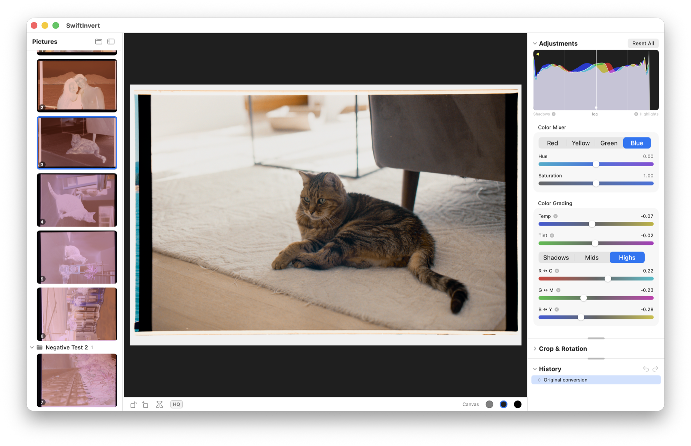

<p align="center">
  
</p>

# SwiftInvert

A desktop film-negative converter — a Rust + egui + wgpu rewrite of
[NegPy](../NegPy)'s C-41 conversion, no Python at runtime. Browse a folder of
camera-scanned negatives, invert with NegPy-quality auto-exposure metering,
refine with darkroom-style controls, and batch-export. One codebase runs on
macOS (Metal), Linux (Vulkan) and Windows (DX12).

The name is historical: SwiftInvert began as a Swift + SwiftUI + Metal app
(with a Qt/Vulkan shell for Linux). That tree was retired on 2026-10-28 once the
Rust port reached parity; its last commit is `e20fcc2` if you ever need it.



## Build & run

```bash
cargo run --release -p swiftinvert [folder]   # the app from source
./build.sh && open dist/SwiftInvert.app       # macOS: package a .app (make app)
make install                                   # …and copy it to /Applications
packaging/linux/install-desktop.sh             # Linux: desktop entry + icon
```

Needs a Rust toolchain (1.95+). RAW decoding is pure Rust (`lightcraft-raw`),
so there is nothing to `brew install`; the LibRaw backend is optional
(`--features libraw`, needs `libraw_r` + headers) and exists as the
byte-exact-vs-NegPy reference. Shaders are WGSL compiled at runtime by wgpu —
no platform shader compiler, no checked-in binaries.

## Features

- Folder-tree library with film-strip previews; multi-select batch export
  (JPEG/TIFF-16, sRGB by default, ICC-tagged and converted via `craft-cms`)
- C-41 inversion with automatic exposure and contrast metering, plus a live
  histogram and an interactive levels window
- Darkroom print controls (brightness, grade, toe/shoulder, True Black,
  contrast mask) and regional tone controls (shadows/highlights and their
  contrasts)
- Color tools: temp/tint, per-band color grading, a chroma-gated Color Mixer
  (R/Y/G/B hue + saturation that never moves neutrals), vibrance/saturation,
  hue trim, skin protection
- Crop, rotate/flip, live straighten; per-image undo/redo history; copy/paste
  adjustments; default-settings profiles; HQ full-resolution preview tiers
- Darkroom read-outs: spot densitometer with a zone strip, zone overlay, zone
  placement, 5×5 test strip, negative-character diagnostic

## Development

```bash
./ci.sh                                   # the quality gate: fmt, clippy -D warnings, cargo test --workspace
NEG_RAW_SAMPLE=/path/file.CR3 ./ci.sh     # …including the real-RAW smoke tests
make test                                 # same thing
cargo run --release -p negcli -- bench /path/file.CR3     # CPU vs GPU bench table
cargo run --release -p swiftinvert -- --selftest out.png <folder> --crop --teststrip --zones --latency
NEG_GPU=off …                             # force the CPU reference renderer
```

Start with `CLAUDE.md` (working guide), then `PLAN.md` (decisions,
architecture, data contracts, test map) and `HANDOFF.md` (state, known gaps).

## Architecture

A Cargo workspace, layered strictly bottom-up (nothing below the UI imports
egui; nothing below the GPU crate imports wgpu):

- `crates/negkit` — pure math, the port of NegPy's conversion kernel:
  log-density analysis, auto-exposure metering, print-curve parameter
  derivation, the CPU reference chain, Lab colour ops, contrast mask, crop
  geometry, densitometry, zones, test strip.
- `crates/negraw` — RAW decode to scene-linear sensor-native RGB under the
  LibRaw contract (unity WB, no camera matrix, EXIF orientation baked).
- `crates/neggpu` — the wgpu compute chain: ONE WGSL module (normalize → H&D
  print curve → color pop → histogram → encode), pinned to the CPU reference.
- `crates/negsession` — the engine: per-image cache tower, sidecars,
  profiles, history, export, library scan. No UI.
- `crates/negui` + `apps/swiftinvert` — the eframe shell. `apps/negcli` — the
  headless driver (decode / thumb / render / meter / bench / export).

## Parity fixtures

`fixtures/` is dumped from the NegPy reference implementation by
`scripts/dump_fixtures.py` (run inside NegPy's environment; see the script
docstring). The `negkit` tests verify each stage boundary against them, and
the GPU is pinned to the CPU reference on top. `UPSTREAM.md` logs every NegPy
review and what was ported or deliberately skipped.

## License

SwiftInvert is licensed under the [GNU General Public License v3.0](LICENSE).
Pure-Rust dependencies (`lightcraft-raw`, `craft-cms`, `craft-ui`, egui, wgpu)
are MIT/Apache-2.0. With the optional `libraw` feature, LibRaw is used under
its LGPL-2.1 option via dynamic linking (LGPL-2.1 §3 permits GPL conversion).
Bundled assets are listed in `assets/ATTRIBUTION.md`.
